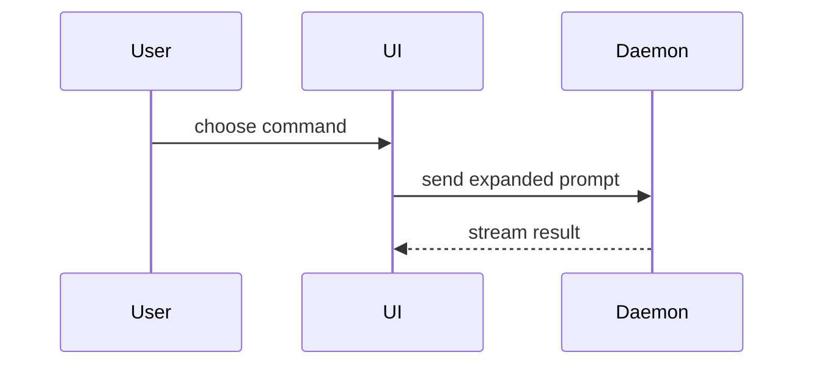

Use this template for writing the PR body, then append the Skwirrel Developer Handoff block described under "Developer Handoff" at the end:

```markdown
## Summary

<diagram, diff-sketch, or tree>

## Evidence

- **Before:** <screenshot/output/failing test run>
  **After:** <screenshot/output/passing test run>

## Merge Danger

**Door:** <one-way or two-way>

<optional: description>

**Blast Radius:** <one-word description>

<optional: potential ramifications of merge>
```

## Sections

Skip all preambles and keep prose brief. Use the user's domain language from `GLOSSARY.md`.

### Summary

Pick the smallest view that makes the key point clear.

- Show logic or an algorithm as pseudocode:

```text
on(save)
  if content is unchanged
    return cached result
  write new content
  return fresh result
```

- Show runtime control flow as a call tree:

```text
submitForm
  createSession
    persistPrompt
    launchAgent
  navigateToSession
```

- Show UI structure as a component tree, including state and module boundaries that matter:

```text
<SessionPage> (apps/example/src/routes/session.tsx)
  useSessionEvents()
  <SessionToolbar>
    <RunSkillButton> (packages/ui)
```

- Show file responsibility or a broad refactor as a shallow file tree:

```text
src/
├── commands/       # parses user actions
├── sessions/       # owns session state
└── transport/      # sends API requests
```

- Show component interaction, control flow, or data flow with Mermaid:



- Use `diff` when the point is what changes and the surrounding shape already exists. Match the diff shape to the topic.

For a component change:

```diff
 <SessionPage>
   useSessionEvents()
   <SessionToolbar>
+    <RunSkillButton />
   <SessionTimeline>
+    <SkillResultCard />
```

For a file-layout change:

```diff
 src/
 ├── commands/
+│   └── show-me.ts       # expands the slash command
 ├── sessions/
-└── transport.ts
+└── transport/
+    ├── client.ts
+    └── stream.ts
```

For a call-tree or call-stack change:

```diff
 submitForm
   createSession
     persistPrompt
+    expandSkillMention
     launchAgent
-  navigateToSession
+  navigateToSession
+    subscribeToEvents
```

For a state or control-flow change:

```diff
 on(save)
-  write content
+  if content is unchanged
+    return cached result
+  write new content
+  invalidate cache
```

- Show the whole block when most of it is new, when omitted context would hide ownership or order, or when the user needs a copyable target shape:

```ts
function expandSkill(command: string): string {
  const skillName = command.slice(1);
  return `use the ${skillName} skill`;
}
```

#### Guidance

Place each visual next to the short text it supports. Keep only the calls, files, props, states, and boundaries needed to answer the user's current question or the options to resolve the current discussion point.

You may use one of these, you may use several, it is unlikely you will use all of them. Use your judgement and don't overwhelm the user.

### Evidence

Concrete evidence that the change works. Show a before and after.

Screenshots are S-tier - when the environment is set up for it and the change is visual.

Execution-based evidence is A-tier. Test results, console output. Show the exact test that now fails and passes, using pseudocode.

### Merge Danger

Describe whether it's a one-way or two-way door. You can walk back through two-way doors, but not one-way doors. A PR that is cheap to roll back is lower risk. Changes that involve destructive actions or hard-to-reverse decisions are one-way doors.

The blast radius is the potential impact or scope of the changes introduced by this PR. Consider all possibilities. Examples are layout shift, breakages for consumers, mobile responsiveness, etc.

## Developer Handoff

After the three sections above, append the Skwirrel **Developer Handoff v1.0**
block (approved for pilot, 16 October 2026). It is the Developer → QA contract
that the QA Analyzer in `Playwright_Skwirrel_2` parses, so keep its headings,
numbering and `**Label:**` lines exactly as below. Fill every field the
available evidence supports; leave the human attestation boxes alone.

Fill from the final diff against the PR base, the linked issues, implementation
context, actual execution records and CI. The handoff adds to Summary, Evidence
and Merge Danger; it does not replace them. Keep the two consistent: Evidence
shows the before/after, Section 4 records what was run; Merge Danger's door and
blast radius should agree with the Section 2 risk.

Do not say the same thing twice. Summary is the visual (diff sketch, tree or
diagram) with at most one caption line. `1. Change Summary` carries the
behaviour and final scope in words, without repeating the visual, plus the why
and the related issues.

```markdown
# Pull Request — Developer Handoff

## 1. Change Summary

**What changed:**
<Implemented behaviour, final scope, relevant acceptance criteria.>

**Why:**
<Problem being solved or reason for the change.>

**Related issues:**
<Closes #123 / Related #123, or None.>

## 2. Impact & Risk

**Affected areas:**
<Product / Trade Item / API / Import-Export / Other, named as workflows.>

**Dependencies:**
<Related components, services, workflows, related PRs potentially affected.>

**Developer-assessed risk:**
<LOW / MEDIUM / HIGH / UNKNOWN>

**Risk reasoning:**
<Preliminary (AI-drafted, pending developer approval): concrete risks,
compatibility, permissions, data/schema impact, rollback concerns.>

## 3. Developer Self Review

*To be completed personally by the developer. Select exactly one option (Done or N/A) for every check.*

**1. I reviewed my code and removed unintended changes.**
- [ ] Done
- [ ] N/A

**2. I checked error handling and relevant edge cases.**
- [ ] Done
- [ ] N/A

**3. I checked permissions, security and data handling.**
- [ ] Done
- [ ] N/A

**4. I checked database/schema impact.**
- [ ] Done
- [ ] N/A

**5. I checked backward compatibility.**
- [ ] Done
- [ ] N/A

**N/A explanations:** Not provided — developer confirmation required.

**Developer confirmation:**
- [ ] Confirmed by developer

## 4. Developer Verification

*Prepared from actual execution records and CI. The developer verifies it.*

**Tests added or updated:**
<Test names or repository-relative paths, or None.>

**Tests executed and results:**
- **Unit:** <command or check>; <PASS / FAIL / NOT RUN / UNKNOWN>; <source>
- **Integration:** <command or check>; <PASS / FAIL / NOT RUN / UNKNOWN>; <source>
- **E2E:** <command or check>; <PASS / FAIL / NOT RUN / UNKNOWN>; <source>
- **Static analysis:** <command or check>; <PASS / FAIL / NOT RUN / UNKNOWN>; <source>

**Evidence:**
<Links to CI runs, logs or test reports. Otherwise: Not available.>

## 5. Known Issues & Limitations

**Failed or skipped checks:**
<None, or each check with its outcome and any explanation.>

**Not verified:**
<None, or the behaviour that remains unverified.>

## 6. Environment & Deployment

**Test environment:**
<Name and URL, or Local.>

**Local setup / deployment instructions:**
<Link to the setup documentation, or brief reproducible instructions.>

**Deployed commit SHA:**
<Commit SHA, or Not yet deployed.>

## How QA can verify

1. <Action, including required role and test data.> Expected: <observable result.>
2. <Relevant edge case or regression check.> Expected: <observable result.>
```

`How QA can verify` is an optional extra after Section 6; the QA Analyzer ignores
it. Omit it when the change needs no manual steps.

### What the AI fills, and what it must not

| Section | Who fills it |
|---|---|
| 1 Change Summary, 2 Affected areas and Dependencies | AI, from the diff, issues and code. The developer reviews. |
| 2 Developer-assessed risk and reasoning | AI drafts a preliminary level; the developer approves it. QA judges risk independently. |
| 3 Developer Self Review, all five checks, N/A explanations, confirmation | **Developer only.** Never tick Done, N/A or Confirmed. |
| 4 Developer Verification | AI, from runs it executed and CI it observed. The developer verifies it. |
| 5 Known Issues & Limitations | AI, from failed, skipped and unrun checks and its own gap list. |
| 6 Environment & Deployment | AI, from git, the running stack and the repo docs. |

### Handoff drafting rules

- Automate every field the evidence supports. Inspect code and documentation to
  resolve gaps first; state what remains unknown. Do not infer the reason for a
  change solely from its implementation; take it from the issue.
- Use `Closes` only for issues the PR actually resolves; otherwise `Related`.
- Name affected workflows and dependency relationships, not just a file list.
- Risk: LOW, MEDIUM, HIGH or UNKNOWN. Use UNKNOWN when the evidence cannot
  support a level. The reasoning is an AI assessment, not developer approval and
  not QA's final risk.
- Never present a test found in source as executed. Separate changed test
  coverage from execution evidence. Give each category its row; use `NOT RUN`
  with a short reason when a category does not apply or was not run.
- Give exact commands or CI check names and results. State the source of each
  result: `agent-executed locally`, `CI observed` (with link), `QA-executed`, or
  `DEVELOPER_REPORTED`. If evidence cannot be shared, say so. Do not use private
  absolute paths as reviewer links.
- `NOT RUN` means execution is known not to have occurred; `UNKNOWN` means
  execution or its result cannot be established. Missing CI is never PASS.
  Record failed, cancelled or skipped checks accurately. A green workflow only
  establishes the checks that actually ran. Do not invent before/after runs or
  screenshots.
- Associate evidence with the revision tested. Flag runs made before later
  changes as stale; do not imply they verify the latest diff.
- Surface every meaningful failure and gap in Section 5, even when it also
  appears in Section 4. Developer explanations are reported explanations, not
  independent verification.
- Deployed commit SHA is the commit actually deployed to the test environment,
  or `Not yet deployed`. Add the PR head SHA as a separate, labelled line when
  useful: `PR head SHA (not deployment proof): <sha>`.
- QA steps are proposed instructions, not execution evidence. Give reproducible
  actions and observable expected results, with roles, prerequisites and test
  data where relevant, plus a meaningful negative or boundary case when
  warranted.
- When updating a PR, refresh scope, results and QA steps for the final change.
  Preserve everything the developer wrote or ticked, especially Section 3, and
  flag conflicts instead of silently replacing them.
- This skill only writes the body. It does not install a PR template in an
  application repository, and it does not authorize publishing or editing PRs.

When handing the body over, tell the developer what is theirs to do: tick
Section 3, approve or change the risk, and verify Section 4. List any field
left UNKNOWN.
